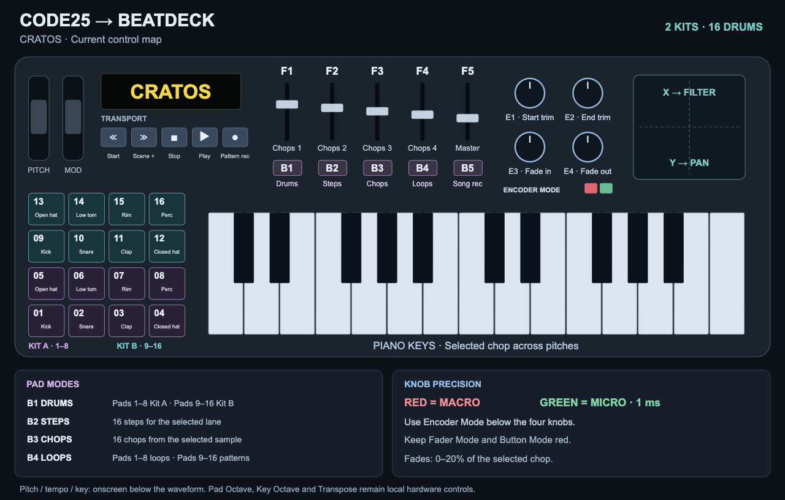

# Controller mappings

## M-Audio Code25 — current main controller

Preset name: **CRATOS**. The reference assignments were captured from physical hardware. Fresh source installations need calibration; personal device IDs and preset backups are excluded.



[Full assignments and setup](Code25-Mapping.md) · [PNG](docs/Code25-current-mappings.png) · [SVG](docs/Code25-current-mappings.svg) · [Interactive document](docs/Code25-current-mappings.html)

| Controls | Beatdeck action |
|---|---|
| Piano keys | Selected chop across pitches; channel 1 |
| Pads 1–8, bottom two rows | Kit A in Drum mode |
| Pads 9–16, top two rows | Kit B in Drum mode |
| E1 / E2 | Sample start / end trim |
| E3 / E4 | Fade-in / fade-out, Macro range up to 20% |
| Encoder Mode | Red Macro; green Micro via paired HUI port |
| F1–F4 / F5 | Chop track 1–4 levels / master |
| B1–B5, below faders | Drums / Steps / Chops / Loops / Song Record |
| Rewind / Forward | Beginning / next scene |
| Stop / Play / Record | Stop / play-stop / pattern record |
| X / Y | Filter / pan |
| Pitch wheel / sustain | Expressive pitch / sustain |

Physical pad order, viewed from above:

```text
Kit B    13  14  15  16
          9  10  11  12
Kit A     5   6   7   8
          1   2   3   4
```

Keep Fader Mode and Button Mode red. Pitch/key and pitch Macro/Micro are onscreen; the local octave and Transpose buttons are not assigned software actions. The modulation wheel shares CC1 with X/filter.

## Native Instruments Maschine MK2

Mapping reported tested and working by the owner. The development history includes pads, Play/Steps/Record workflow, setup tools and fixes for echoed transport/button behavior. This documentation update does not replace the working preset or imply a fresh hardware test.

The exact legacy per-control MIDI assignment table and portable preset file have not been archived in this clean repository. Preserve the installed working profile; do not substitute guessed assignments. Capturing a shareable profile is planned for the native rebuild.

## Alesis Vortex Wireless

Mapping reported tested and working by the owner; introduced between the November 1 and November 13, 2026 milestones. Existing support is retained. No fresh Vortex hardware test was performed for this documentation update.

The exact legacy per-control MIDI assignment table and portable preset file have not been archived in this clean repository. Preserve the installed working profile. A portable profile and native-rebuild acceptance test are planned.

[Version history](CHANGELOG.md) · [Roadmap](ROADMAP.md)
