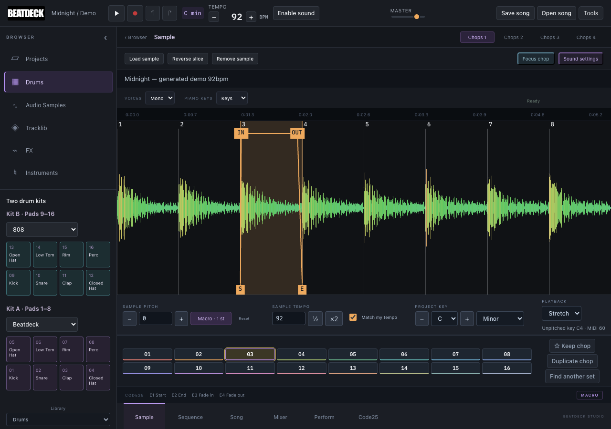
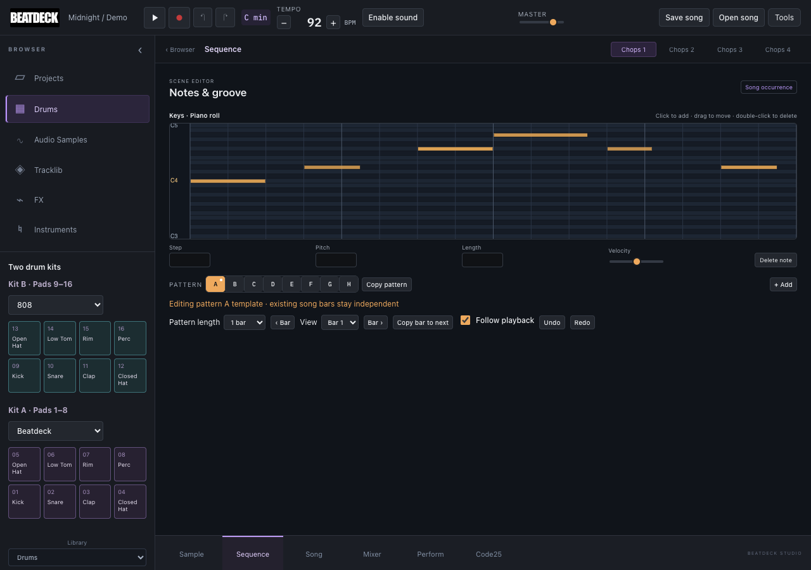
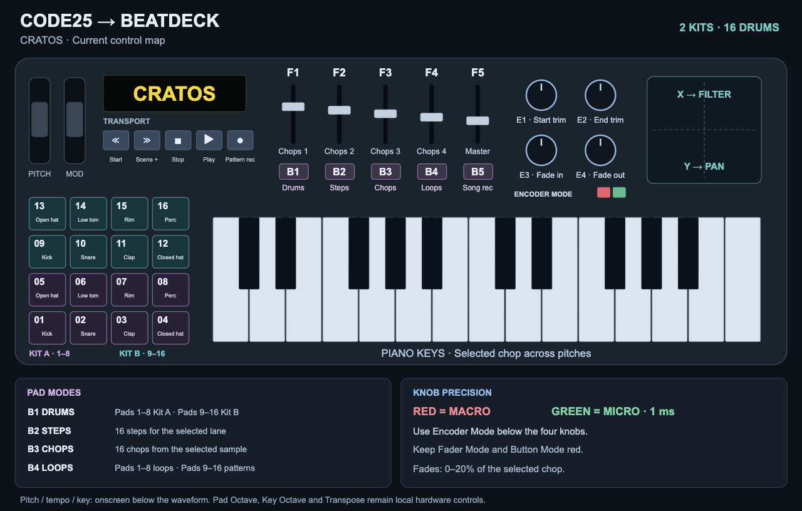

<div align="center">

# BEATDECK STUDIO

### Chop samples. Play melodies. Build beats.

A local music workspace from **XTRA GOOD LABS** — built around hands-on sampling and MIDI performance.

[](https://github.com/XTRAGOODLABS/beatdeck-studio/actions/workflows/ci.yml)
[](https://github.com/XTRAGOODLABS/beatdeck-studio/releases/tag/v1.0.1)


[**Website**](https://xtragoodlabs.github.io/beatdeck-studio/) · [**Download for Mac**](https://github.com/XTRAGOODLABS/beatdeck-studio/releases/download/v1.0.1/Beatdeck-1.0.1-macOS-arm64.dmg) · [**Controller map**](Controller-Mappings.md) · [**Version history**](CHANGELOG.md) · [**What's next**](ROADMAP.md) · [**Buy me a coffee ☕**](https://buymeacoffee.com/xtragoodlabs) · [**More from XTRA GOOD LABS**](https://github.com/XTRAGOODLABS)

</div>



*The current app, shown with a generated demo loop. Kit B sits above Kit A, matching the Code25.*

## From a sample to a song

| Chop & play | Sequence & arrange | Perform & explore |
|---|---|---|
| Waveform trimming, fades and 16 chop pads | Melodic piano roll and drum sequencing | Code25 controls with Macro/Micro precision |
| Four chop tracks and melodic sample playing | Patterns, scenes and song arrangement | Two independent eight-piece drum kits |
| Independent pitch/tempo in Stretch mode | Portable projects and WAV export | Separate Tracklib browser and local libraries |

## Notes & groove



*Write melodic phrases, adjust note lengths and velocity, then build patterns into a song.*

## Hands on

**Code25** is the current main controller. **Maschine MK2** and **Alesis Vortex Wireless** mappings are also recorded as tested and working by the owner. See the controller guide for verification details and the available assignment tables.

<details>
<summary><strong>Show the Code25 physical control map</strong></summary>



[Full setup and MIDI assignments](Code25-Mapping.md) · [Download PNG](docs/Code25-current-mappings.png) · [Download SVG](docs/Code25-current-mappings.svg)

</details>

## Next: the native chapter

The planned **JUCE rebuild** carries this workflow into a native audio/MIDI engine, with VST3/AU effects hosting, project migration and existing controller support as priorities. These are planned features; today's release uses Electron and JavaScript. [Read the roadmap →](ROADMAP.md)

---

## History, roadmap and controllers

- [Combined version history](CHANGELOG.md), including the original Claude milestones and Studio work.
- [Planned expansion and JUCE rebuild](ROADMAP.md).
- [Controller mappings and illustrated Code25 map](Controller-Mappings.md), including the tested Maschine MK2 and Alesis Vortex Wireless status.

## Install on Mac — no build required

[**Download Beatdeck for Apple Silicon (.dmg)**](https://github.com/XTRAGOODLABS/beatdeck-studio/releases/download/v1.0.1/Beatdeck-1.0.1-macOS-arm64.dmg)

Requires an **Apple Silicon Mac (M-series), macOS 13 Ventura or newer**. Open the DMG, drag Beatdeck to Applications, eject the image, then open the app. No Node.js or developer tools required. Intel Macs are not supported by this download.

This initial download is **not Developer ID signed or Apple-notarized**. If macOS blocks it and you trust the release, use **System Settings → Privacy & Security → Open Anyway** after trying to launch it. [Installation guide](INSTALL-MAC.md) · [Apple's instructions](https://support.apple.com/en-us/102445).

## Run from source

Use Node.js 22.12 or newer and npm:

```sh
npm ci
npm start
```

Source runs use a separate **Beatdeck-Dev** application-data folder. They do not import or overwrite an installed Beatdeck library, recovery file or MIDI configuration. Set `BEATDECK_DATA_DIR` to choose another development data folder. The primary tested platform is macOS; Windows and Linux device behavior is not verified.

## Make a beat

1. Select a Chops track and load audio from your local library.
2. Trim and fade a selected chop. Keys plays it melodically; Chops assigns successive keys to slices. Mono chokes the previous voice; Poly permits chords.
3. Adjust sample pitch, source BPM, Match tempo, project key/scale and Stretch/Tape directly below the waveform. Pitch Macro steps one semitone; Micro steps 0.01 semitone.
4. Use Sequence for melodic notes and drum steps, then arrange scenes in Song. Linked repeats share edits; independent variations have their own notes.
5. Save a portable `.beatdeck` project using the File menu. Audio export goes to Downloads.

Stretch changes sample tempo and pitch independently using SoundTouch. Tape links playback speed and pitch. Live loop clips retain their speed-based playback engine. Stretch output can have artifacts; it does not reproduce Serato Pitch ’n Time or preserve vocal formants.

## Notes and octave labels

The unpitched sample reference is shown below the waveform, including its MIDI note number. Middle C defaults to **C4 (MIDI 60)**. Sound settings offers C3 labels for the same MIDI note. This local display preference changes piano-roll labels only; sample pitch, recorded notes and controller mappings are unchanged. The sample’s own Pitch setting still applies at its reference key.

## Code25

See [controller setup and mappings](Code25-Mapping.md). Existing assignments in the same application-data profile are retained. Unknown hardware messages are learned rather than guessed. This source package excludes personal MIDI device IDs and local configuration backups. First-time source runs need their own controller calibration.

## Tracklib

Tracklib is a separate **local folder library**, with its own folder selector, Refresh, search, Audition and Load. Cards start collapsed. If `~/Desktop/TRACKLIB` exists, it is offered as the initial source. Other folders can be registered with + Folder. Samples and Drums remain separate; source audio is never moved or modified. No Tracklib audio, account integration or clearance is supplied by this repository.

## Checks

```sh
npm run check
npm test
```

The syntax check includes embedded engine scripts and local script/style references. Tests cover MIDI routing, pickup and precision, library separation and audio pitch/tempo processing. CI runs those checks with Node 24. Browser integration scripts in `tests/*-browser.js` must be evaluated in an isolated test window: they replace the test project and must never run in a live song. Native dialogs, hardware input and listening quality require manual verification.

## Distribution status

GitHub v1.0.0 was the initial source release. GitHub v1.0.1 adds an Apple Silicon Mac app download. The app has an ad-hoc integrity signature and is not Developer ID signed or notarized. The development Electron version is pinned in the lockfile and source startup was verified in an isolated macOS development profile. The existing installed application remains independent. The public repository is maintained at https://github.com/XTRAGOODLABS/beatdeck-studio.

Project code is **UNLICENSED** until its owner chooses distribution terms. SoundTouchJS has its own LGPL 2.1-or-later license and notices in [vendor](vendor/SoundTouchJS-NOTICE.md). No Serato code or assets are included.

## Two drum kits

Drum mode uses all 16 pads: Kit A on pads 1–8 in the lower two rows, Kit B on pads 9–16 in the upper two rows. The app follows the physical controller layout, with Kit B above Kit A. Each eight-piece kit has its own chooser, samples, tone bus and sequencer lanes. Choke groups are independent between the kits. Existing eight-drum songs migrate their chop notes and mixer settings when opened. New projects support up to 28 embedded audio assets: sixteen drums, four chops and eight loops. [Current Code25 map](docs/Code25-current-mappings.png).
